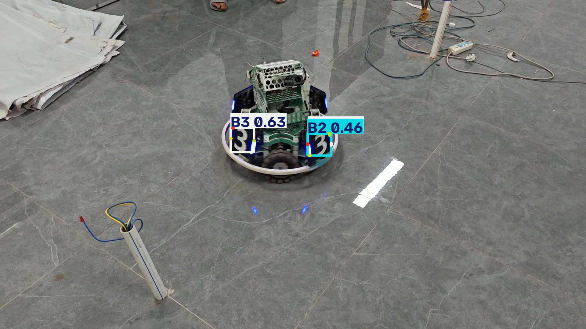

# YOLO 装甲板检测模型导出与性能基准测试

本项目用于评估 YOLO26 Pose
模型在不同部署格式下的模型体积、推理延迟和检测输出差异。项目覆盖原始
PyTorch 权重、ONNX、TorchScript 与 OpenVINO，并对 ONNX 和 OpenVINO 的
FP32、FP16 导出结果进行对比。

项目面向模型部署与复现实验，不包含模型训练流程，也不涉及机器人控制或自动瞄准功能。

## 项目概览

主要功能：

- 将 PyTorch 权重导出为 ONNX、TorchScript 和 OpenVINO 格式。
- 对 ONNX、OpenVINO 导出 FP16 模型，并与 FP32 模型比较。
- 使用相同输入视频、输入尺寸和推理阈值运行模型。
- 统计模型文件大小、平均推理延迟、P50/P95 延迟、推理 FPS 和检测数量。
- 提取同一视频帧的推理结果图片，便于检查不同格式的输出差异。
- 将原始测量数据保存为 CSV，并提供可复现的命令行流程。

当前模型为 **YOLO26n-pose**，模型摘要记录为 2,447,934 个参数、约 5.6
GFLOPs。模型类别为 `B1`、`B2`、`B3`、`R1`、`R2` 和 `R3`。

## 支持的模型配置

| 配置             | 模型格式    | 精度 | 模型路径                                |
|------------------|-------------|------|-----------------------------------------|
| PyTorch FP32     | PyTorch     | FP32 | `weights/best.pt`                       |
| ONNX FP32        | ONNX        | FP32 | `models/best.onnx`                      |
| ONNX FP16        | ONNX        | FP16 | `models/fp16/best_fp16.onnx`            |
| TorchScript FP32 | TorchScript | FP32 | `models/best.torchscript`               |
| OpenVINO FP32    | OpenVINO    | FP32 | `models/best_openvino_model/`           |
| OpenVINO FP16    | OpenVINO    | FP16 | `models/fp16/best_fp16_openvino_model/` |

**当前环境限制：** 测试环境未检测到可用 CUDA，因此没有生成 TorchScript
FP16 模型。TorchScript 仅作为 FP32 对照组；FP16 对比包含 ONNX 和
OpenVINO 两种格式。

## 项目结构

``` text
yolo-armor-deployment-benchmark/
├── README.md
├── .gitignore
├── requirements.txt
├── export.py                   # 导出 FP32 模型
├── export_fp16.py              # 导出可用的 FP16 模型
├── inference.py                # 单模型视频推理与计时
├── benchmark.py                # 六种配置的基准测试
├── extract_frames.py            # 提取统一帧号的对比图片
├── weights/
│   └── best.pt                  # 原始模型权重
├── models/
│   ├── best.onnx
│   ├── best.torchscript
│   ├── best_openvino_model/
│   └── fp16/
│       ├── best_fp16.onnx
│       └── best_fp16_openvino_model/
├── images/
│   ├── pt_frame_200.png
│   ├── onnx_frame_200.png
│   ├── onnx_fp16_frame_200.png
│   ├── torchscript_frame_200.png
│   ├── openvino_frame_200.png
│   └── openvino_fp16_frame_200.png
├── reports/
│   ├── benchmark_results.csv
│   └── comparison.md
├── videos/
│   └── original.mp4             # 本地测试输入
└── results/
    └── *_output.mp4              # 本地生成的推理视频
```

实际仓库内容可能因是否保留模型导出产物而有所不同。若模型文件因体积、许可或分发限制未提交，请按下文说明在本地重新生成。

## 测试环境

以下信息来自本次运行日志与项目环境记录：

| 项目         | 版本或配置                     |
|--------------|--------------------------------|
| 操作系统     | Windows                        |
| Python       | 3.10.22                        |
| PyTorch      | 2.14.1+cpu                     |
| Ultralytics  | 8.4.177                        |
| ONNX         | 1.23.2                         |
| ONNX Runtime | 1.23.2                         |
| onnxslim     | 0.1.98                         |
| OpenVINO     | 2026.4.1                       |
| 推理设备     | CPU                            |
| CPU          | Intel Core i5-7200U @ 2.50 GHz |
| CUDA         | 当前测试环境不可用             |

依赖项以仓库中的 `requirements.txt`
为准。不同操作系统、运行库版本和硬件可能产生不同结果。

## 安装与输入准备

建议使用 Python 3.10 的独立环境。使用 Conda 的示例：

``` powershell
conda create -n yolo-export-benchmark python=3.10 -y
conda activate yolo-export-benchmark
python -m pip install -r requirements.txt
```

准备模型权重与测试视频：

- 将有权使用的模型权重放在 `weights/best.pt`。
- 将有权使用的测试视频放在 `videos/original.mp4`。
- 视频文件仅用于本地测试，不需要上传到 GitHub。

检查文件是否存在：

``` powershell
Test-Path .\weights\best.pt
Test-Path .\videos\original.mp4
```

两个命令均应返回 `True`。

## 导出模型

### 导出 FP32 模型

在仓库根目录运行：

``` powershell
python .\export.py
```

脚本会尝试导出 ONNX、TorchScript 和 OpenVINO
模型。导出成功后仍需运行推理，确认产物可正常加载与使用。

### 导出 FP16 模型

``` powershell
python .\export_fp16.py
```

当前环境成功生成了 ONNX FP16 和 OpenVINO FP16 模型。TorchScript FP16
因当前环境未检测到 CUDA 而跳过，因此不纳入 FP16 性能表。

FP16 表示导出模型的数值精度配置，不代表所有硬件和运行时都会以 FP16
执行全部算子。尤其在 CPU
上，实际收益取决于硬件指令支持、运行时实现和算子覆盖情况。

## 运行推理

以下命令均从仓库根目录执行，输入默认为
`videos/original.mp4`，输出为本地生成的视频文件。

### PyTorch FP32

``` powershell
python .\inference.py --model weights/best.pt --format pt --output results/pt_output.mp4
```

### ONNX FP32

``` powershell
python .\inference.py --model models/best.onnx --format onnx --output results/onnx_output.mp4
```

### ONNX FP16

``` powershell
python .\inference.py --model models/fp16/best_fp16.onnx --format onnx --output results/onnx_fp16_output.mp4
```

### TorchScript FP32

``` powershell
python .\inference.py --model models/best.torchscript --format torchscript --output results/torchscript_output.mp4
```

### OpenVINO FP32

``` powershell
python .\inference.py --model models/best_openvino_model --format openvino --output results/openvino_output.mp4
```

### OpenVINO FP16

``` powershell
python .\inference.py --model models/fp16/best_fp16_openvino_model --format openvino --output results/openvino_fp16_output.mp4
```

推理脚本会打印统计信息并生成带有检测可视化的视频，包括类别、置信度、检测框以及模型支持的关键点标注。

## 基准测试方法

运行全部六种配置并重新生成 CSV 报告：

``` powershell
python .\benchmark.py
```

报告保存到：

``` text
reports/benchmark_results.csv
```

当前对比采用以下统一参数：

| 参数                       | 数值 |
|----------------------------|-----:|
| 输入视频帧数               |  483 |
| 预热帧数（不计入延迟统计） |   10 |
| 测量帧数                   |  473 |
| 输入尺寸                   |  640 |
| Batch size                 |    1 |
| 置信度阈值                 | 0.31 |
| IoU 阈值                   | 0.70 |
| 设备                       |  CPU |

延迟指标为脚本记录的模型推理耗时。`FPS` 按平均推理延迟的倒数计算，即
`1000 / 平均推理延迟（ms）`。它不等同于包含视频解码、绘制、编码与文件写入的端到端应用帧率。

## 性能测试结果

下表为本次提供的同一轮基准测试结果。模型大小采用脚本输出值；数值按
MiB（1024²
字节）理解。实际运行结果可能受系统负载、运行库、模型文件和硬件状态影响。

| 模型配置         | 大小（MiB） | 平均延迟（ms） | P50（ms） | P95（ms） |     FPS | 检测总数 | 平均置信度 |
|------------------|------------:|---------------:|----------:|----------:|--------:|---------:|-----------:|
| PyTorch FP32     |       5.619 |        99.0745 |   89.2822 |  137.8162 | 10.0934 |      747 |     0.6474 |
| ONNX FP32        |       9.724 |       132.6017 |  120.5570 |  203.5294 |  7.5414 |      769 |     0.6527 |
| ONNX FP16        |       4.927 |       130.4229 |  122.2442 |  168.9096 |  7.6674 |      771 |     0.6515 |
| TorchScript FP32 |       9.946 |       173.8711 |  156.2717 |  233.6732 |  5.7514 |      769 |     0.6527 |
| OpenVINO FP32    |       9.878 |        87.2455 |   38.3489 |  306.5418 | 11.4619 |      771 |     0.6507 |
| OpenVINO FP16    |       5.265 |        86.8170 |   36.4021 |  305.3475 | 11.5185 |      771 |     0.6505 |

所有配置处理了同一个 483
帧视频。检测总数按本次推理脚本的统计结果记录；预热帧只从延迟统计中排除，不应将检测数量当作独立的模型准确率指标。

### 结果解读

- **模型体积明显下降。** ONNX FP16 为 4.927 MiB，相比 ONNX FP32 的 9.724
  MiB 减少约 **49.3%**。OpenVINO FP16 为 5.265 MiB，相比 OpenVINO FP32
  的 9.878 MiB 减少约 **46.7%**。
- **本次 CPU 测试中，FP16 的平均延迟改善有限。** ONNX FP16 平均延迟为
  130.4229 ms，略低于 FP32 的 132.6017 ms；OpenVINO FP16 为 86.8170
  ms，略低于 FP32 的 87.2455 ms。该幅度不足以证明 FP16
  在其他设备上也会有相同收益。
- **OpenVINO 的 P50 较低，但 P95 较高。** OpenVINO FP32 与 FP16 的 P95
  分别为 306.5418 ms 和 305.3475 ms，明显高于各自的
  P50。这说明单看平均值或中位数不足以判断延迟稳定性；部署时应进一步检查长尾延迟并进行多轮测试。
- **不同格式的检测数量接近但不完全相同。** 本次检测总数介于 747 到 771
  之间，可能与数值精度、算子实现和后处理差异有关。检测数量或平均置信度本身不能替代标注数据上的
  Precision、Recall 或 mAP。
- **本表仅代表当前 CPU 环境。** 当前环境未检测到 CUDA，不应将结果解读为
  NVIDIA GPU 上的性能排名。

原始数据请查看
[`reports/benchmark_results.csv`](reports/benchmark_results.csv)；补充分析请查看
[`reports/comparison.md`](reports/comparison.md)。

## 检测结果可视化

在六种配置的推理视频生成后，运行以下命令提取第 200 帧：

``` powershell
python .\extract_frames.py
```

脚本使用从 0 开始的帧索引 `199`，并以便于阅读的 `frame_200`
命名文件。下列图片用于定性观察相同画面中的检测框、类别、置信度和关键点差异。

### PyTorch FP32


### ONNX

| ONNX FP32                                        | ONNX FP16                                             |
|--------------------------------------------------|-------------------------------------------------------|
|  |  |

### TorchScript FP32


### OpenVINO

| OpenVINO FP32                                            | OpenVINO FP16                                                 |
|----------------------------------------------------------|---------------------------------------------------------------|
|  |  |

图片仅用于定性比较。若需评价检测精度，应使用带标注的验证集计算相应指标，而不应只依据单帧截图。

## 常见问题

### 导出成功但推理失败

导出成功并不代表所有运行时都能正常加载模型。请确认模型路径、依赖版本和运行时格式匹配，并逐一运行对应的推理命令。

### FP16 文件变小但速度提升不明显

模型文件体积减少不保证 CPU
推理延迟按相同比例下降。硬件对半精度运算的支持、运行时算子实现及数据转换开销都会影响最终表现。

### 不同格式的检测结果不完全一致

请固定输入视频、输入尺寸、置信度阈值和 IoU
阈值，并对比同一帧的检测框、类别、置信度与关键点。如果需要量化精度差异，应使用具有真实标注的数据集计算
Precision、Recall、mAP 等指标。

## 结论

本项目完成了 YOLO26n-pose 模型在 PyTorch、ONNX、TorchScript 和 OpenVINO
格式下的推理对比，并进一步测试了 ONNX 与 OpenVINO 的 FP16 导出结果。

在当前 CPU 测试中，FP16 显著减小了 ONNX 与 OpenVINO
模型文件体积，但平均推理延迟的改善较小。OpenVINO
配置的平均延迟较低，不过 P95
延迟较高，仍需结合延迟分布、目标硬件和实际部署要求评估。不同格式的检测数量存在小幅差异；由于本次结果不是基于标注验证集的精度评估，不能据此判断哪种格式具有更高的检测准确率。

这些结论仅适用于本次模型、软件环境、测试视频和 CPU
配置。部署决策应在目标设备上重新测试，并结合标注数据上的精度指标与端到端时延进行评估。
